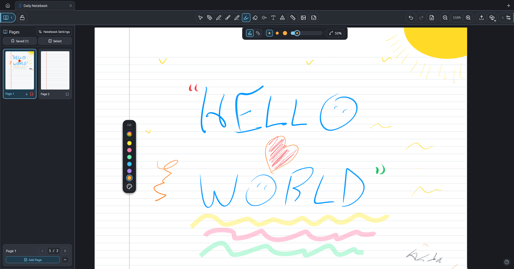
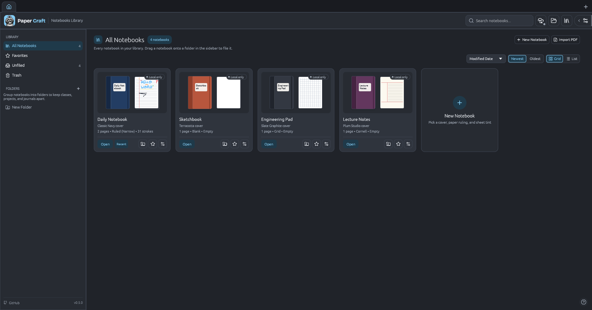
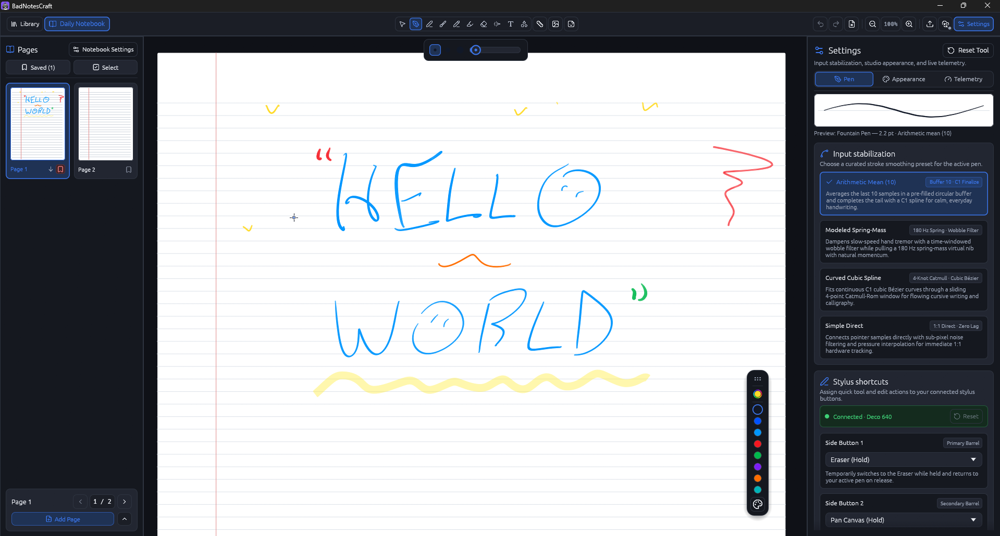
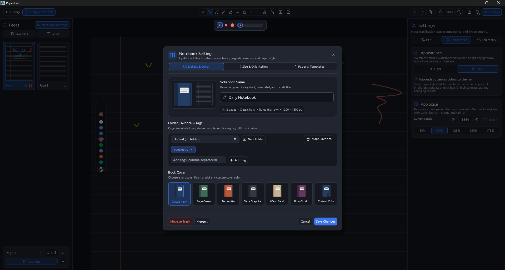
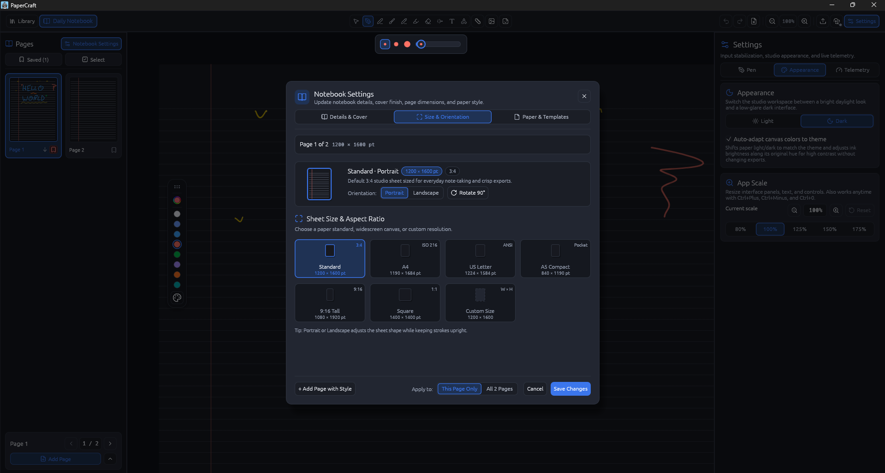
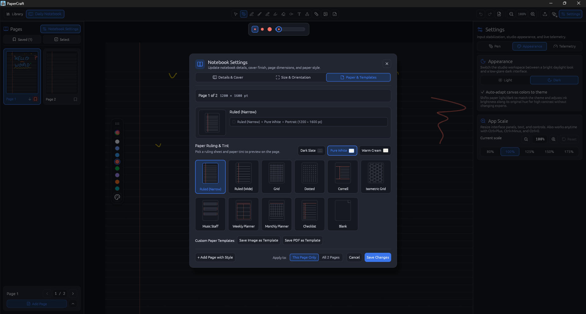

<p align="center">
  
</p>

<h1 align="center">PaperCraft</h1>
<p align="center">
  <b>A native notebook and handwriting studio, built in pure Rust.</b><br>
  Write across pages, choose your paper, and export your notes in a few clicks.
</p>
<p align="center">
  <a href="https://github.com/Alyx-Labs/papercraft/releases/latest"></a>
  <a href="#downloads"></a>
  
  <a href="https://web.papercraft.ink/"></a>
  
</p>

<p align="center">
  
  <br>
  <sub>The notebook workspace, with the page sidebar, writing toolbar, floating color dock, and interactive ruler.</sub>
</p>

<p align="center">
  <a href="https://web.papercraft.ink/">🌐 Live Demo</a> ·
  <a href="#downloads">⬇️ Downloads</a> ·
  <a href="#project-status--vision-initial-alpha">Alpha &amp; Vision</a> ·
  <a href="#features">Features</a> ·
  <a href="#everything-in-the-box">Everything in the box</a> ·
  <a href="#file-formats">File formats</a> ·
  <a href="#under-the-hood">Under the hood</a> ·
  <a href="#get-started">Get started</a> ·
  <a href="#contributing--ai-assisted-development">Contributing</a> ·
  <a href="#documentation">Documentation</a> ·
  <a href="#security">Security</a>
</p>

> [!IMPORTANT]
> **Initial Alpha — Concept Validation & Community Release**
>
> PaperCraft is currently in an **initial alpha** phase focused on validating the core concept, handwriting feel, and local-first architecture together with the community. Development is intentionally **unhurried and focused on staying extremely lightweight**—prioritizing responsiveness, stability, and clean pure-Rust foundations over feature bloat.
>
> - **Future mobile ports:** Because the drawing, document, format, and sync engine (`L0–L5`) is strictly decoupled from the UI shell (`L6`), the long-term goal after validating the desktop/web alpha is to bring lightweight native ports to **Android, iOS, and tablets** without rewriting the core.
> - **AI-assisted contributions are strongly encouraged:** Community contributors are warmly encouraged to use AI coding assistants to explore, fix bugs, and build improvements—provided every change **strictly follows [`AGENTS.md`](AGENTS.md)** and passes `cargo xtask ci` so the app stays fast and crash-free.
> - **Alpha data tip:** While the format and sync engine mature, keep periodic backups of your `library/` folder or export important notebooks as `.pcraft` / `.pcraftpkg`.

## Project status & vision (Initial Alpha)

PaperCraft is built around three simple principles:

1. **Extremely lightweight & calm evolution:** Pure Rust from the geometry math to the UI and sync server, with zero heavy runtime overhead and no rush to chase bloated features.
2. **Local-first by default, effortless multi-account sync when you want it:** You can run PaperCraft **100% locally and offline** with no server at all. For the **ideal everyday setup**, run the lightweight **`papercraft-server`** system-tray app quietly in the background—letting you create **multiple isolated local accounts** (for example, personal, study, or work) and sync seamlessly across devices. Pair it with any **private encrypted mesh VPN** to access and sync your self-hosted notebooks securely from anywhere, without relying on third-party cloud services.
3. **Built to port cleanly:** Once the core concept and workflows are validated with the community on Desktop and Web, the layered engine is designed to expand into lightweight **Android and iOS** ports sharing the same core crates.

<br>
<table>
  <tr>
    <td width="25%" valign="top">
      <h3>✍️ Made for handwriting</h3>
      Use fountain, ball, and brush pens, a highlighter, and an eraser with pressure-aware strokes.
    </td>
    <td width="25%" valign="top">
      <h3>📖 Your pages, your way</h3>
      Start with lined, grid, dotted, Cornell, or blank paper, then choose a sheet tint.
    </td>
    <td width="25%" valign="top">
      <h3>🎨 Quick to adjust</h3>
      Set ink color and thickness from the toolbar, then pick one of four smoothing feels in Settings.
    </td>
    <td width="25%" valign="top">
      <h3>🗂️ Local-first notebooks</h3>
      Keep notebooks in your local library and optionally sync through the self-hosted Server Tray App or CLI.
    </td>
  </tr>
</table>

## Downloads

> **Live Web Demo:** Try PaperCraft directly in your browser at **[https://web.papercraft.ink/](https://web.papercraft.ink/)** — runs 100% client-side via WebAssembly with no installation required.

Pre-built binaries are published on [GitHub Releases (`v0.8.1-alpha`)](https://github.com/Alyx-Labs/papercraft/releases/latest) for **Windows**, **Linux**, and **macOS**. PaperCraft ships as **two separate standalone apps**—install the Desktop App on its own for offline note-taking, and add the Server only if you want self-hosted multi-device sync:

<table>
  <tr>
    <td width="50%" valign="top">
      <h3>📓 PaperCraft App (Desktop)</h3>
      <p>The notebook &amp; handwriting workspace. Works <b>100% offline</b> with local accounts out of the box.</p>
      <ul>
        <li><b>Windows</b> (<code>x86_64</code>): <a href="https://github.com/Alyx-Labs/papercraft/releases/latest/download/papercraft-windows-x86_64-portable.exe"><code>papercraft-windows-x86_64-portable.exe</code></a> <sub>(portable <code>.exe</code>)</sub></li>
        <li><b>Linux</b> (<code>x86_64</code>): <a href="https://github.com/Alyx-Labs/papercraft/releases/latest/download/papercraft-linux-x86_64.AppImage"><code>papercraft-linux-x86_64.AppImage</code></a> <sub>(<code>chmod +x</code> before running)</sub></li>
        <li><b>macOS</b> (<code>arm64</code>): <a href="https://github.com/Alyx-Labs/papercraft/releases/latest/download/papercraft-macos-arm64.dmg"><code>papercraft-macos-arm64.dmg</code></a> <sub>(Apple Silicon · experimental)</sub></li>
      </ul>
    </td>
    <td width="50%" valign="top">
      <h3>☁️ PaperCraft Server (System Tray — Optional)</h3>
      <p>Optional self-hosted sync server &amp; account manager that sits in your tray (LAN or private mesh VPN).</p>
      <ul>
        <li><b>Windows</b> (<code>x86_64</code>): <a href="https://github.com/Alyx-Labs/papercraft/releases/latest/download/papercraft-server-windows-x86_64-portable.exe"><code>papercraft-server-windows-x86_64-portable.exe</code></a> <sub>(portable <code>.exe</code>)</sub></li>
        <li><b>Linux</b> (<code>x86_64</code>): <a href="https://github.com/Alyx-Labs/papercraft/releases/latest/download/papercraft-server-linux-x86_64.AppImage"><code>papercraft-server-linux-x86_64.AppImage</code></a> <sub>(<code>chmod +x</code> before running)</sub></li>
        <li><b>macOS</b> (<code>arm64</code>): <a href="https://github.com/Alyx-Labs/papercraft/releases/latest/download/papercraft-server-macos-arm64.dmg"><code>papercraft-server-macos-arm64.dmg</code></a> <sub>(Apple Silicon · experimental)</sub></li>
      </ul>
    </td>
  </tr>
</table>

> [!IMPORTANT]
> **Portable setup & where to place the files (`papercraft` and `papercraft-server`):**
>
> Both **PaperCraft App** and **PaperCraft Server** ship as self-contained portable applications with no separate installer. Before launching them for the first time, **move each executable (`.exe` / `.AppImage`) or `.app` bundle into the permanent, writable folder where you want to keep and run it** (for example `C:\Users\<you>\Apps\PaperCraft\` on Windows, `~/Applications/PaperCraft/` on Linux, or `/Applications` on macOS — avoid running from a temporary `Downloads` folder or read-only system directories like `C:\Program Files`):
>
> - **Portable data & updates live right next to the executable:** On Windows and Linux, the Desktop app creates `library/` and the Server creates `server_control_config.json` and `server-data/` beside the executable (and on all platforms, in-app updates replace that file in place).
> - **Automatic Desktop shortcut:** Both apps have a **Create Desktop shortcut automatically** switch enabled by default (**Settings -> System -> App Updates** in the Desktop app, and **App Updates** in `papercraft-server`). It creates a native launcher (`PaperCraft.lnk` / `PaperCraft Server.lnk` on Windows, a `.desktop` launcher + icon in `XDG_DESKTOP_DIR` on Linux, or a `.app` link on macOS) pointing to that permanent folder, and **automatically refreshes the shortcut whenever the app updates** so you never have to search for the executable.

<details>
<summary><b>WebAssembly bundle, SHA-256 checksums, headless CLI server, and platform notes</b></summary>

- **Live Web Demo (WebAssembly):** [web.papercraft.ink](https://web.papercraft.ink/) — runs 100% client-side in your browser via WebAssembly (or download [papercraft-web.zip](https://github.com/Alyx-Labs/papercraft/releases/latest/download/papercraft-web.zip) to host on any static web server).
- **Checksums & all assets:** [SHA256SUMS.txt](https://github.com/Alyx-Labs/papercraft/releases/latest/download/SHA256SUMS.txt) on the [GitHub Releases page](https://github.com/Alyx-Labs/papercraft/releases/latest).
- **Headless terminal server (`papercraft-server-cli`):** For Linux/server hosts without a desktop tray, build from source with `cargo build --release -p papercraft-server-cli`.
- **macOS notice:** macOS `.dmg` builds are compiled and packaged in GitHub Actions, but remain **experimental** (not yet tested on physical Mac hardware).

</details>

## Features

PaperCraft brings notebooks, paper, and a pressure-aware drawing engine together in one focused desktop workspace.

<table>
  <tr>
    <td width="50%" valign="top">
      
      <br>
      <sub>Organize notebooks into folders, star favorites, and search across your local or synced library.</sub>
      <h3>Organize your library</h3>
      Search notebooks, file books into folders, open <code>.pcraft</code> files or import PDFs, and return to recent pages from their cards.
    </td>
    <td width="50%" valign="top">
      
      <br>
      <sub>Preview smoothing live and map barrel buttons to quick actions on connected styluses.</sub>
      <h3>Tune pen feel &amp; stylus shortcuts</h3>
      Switch between four one-click input stabilization presets with a live stroke preview and customize side-button shortcuts for connected styluses.
    </td>
  </tr>
</table>

<h3>Customize covers, page sizes, and paper templates</h3>

<table>
  <tr>
    <td width="33%" valign="top">
      
      <br>
      <sub><b>1. Details &amp; Cover:</b> Rename notebooks, assign folders, star favorites, add tags, and choose a hardcover finish or custom color.</sub>
    </td>
    <td width="33%" valign="top">
      
      <br>
      <sub><b>2. Size &amp; Orientation:</b> Pick Standard, A4, US Letter, A5 Compact, 9:16 Tall, Square, or custom dimensions in Portrait or Landscape.</sub>
    </td>
    <td width="33%" valign="top">
      
      <br>
      <sub><b>3. Paper &amp; Templates:</b> Combine sheet tints with 11 built-in rulings and planners, or save any image or PDF as a reusable template.</sub>
    </td>
  </tr>
</table>

<table>
  <tr>
    <td width="50%" valign="top">
      <h3>Ink that follows your hand</h3>
      Draw with fountain, ball, brush, and pencil pens. Pen samples can include pressure, tilt, rotation, barrel-button state, and eraser-end input where the platform provides them.
      <br><br>
      Choose ink color, favorites, and thickness from the toolbar. A separate highlighter, precision eraser (with optional highlighter-only mode), ruler, shapes with Draw &amp; Hold recognition, and laser pointer keep common workflows close at hand.
    </td>
    <td width="50%" valign="top">
      <h3>Four writing feels</h3>
      Settings offers four one-click smoothing presets: Arithmetic Mean (10), Modeled Spring-Mass, Curved Cubic Spline, and Simple Direct. A live stroke preview shows how each choice shapes the line before you write with it.
    </td>
  </tr>
  <tr>
    <td width="50%" valign="top">
      <h3>Paper, PDFs, and custom templates</h3>
      Create multi-page notebooks with reusable cover, page size/orientation, and paper presets—including ruled, grid, dotted, Cornell, isometric, music staff, planner, checklist, or custom image/PDF templates.
      <br><br>
      Import PDFs as annotatable notebooks or insert PDF pages directly into an existing book with a protected background layer.
    </td>
    <td width="50%" valign="top">
      <h3>Rich editing in a calm workspace</h3>
      Add rich text boxes, raster images, stickers, and geometric shapes, then organize selections with freeform lasso or box selection and copy/paste across pages.
      <br><br>
      Switch between light and dark studio themes, manage page thumbnails in the left sidebar, and adjust pen or stylus settings in the right drawer.
    </td>
  </tr>
</table>

## Everything in the box

<table>
  <tr>
    <td width="33%" valign="top">
      <h4>🖊️ Writing &amp; presentation tools</h4>
      Fountain, ball, brush, and pencil pens, highlighter, stroke/precision eraser (including highlighter-only mode), ruler, Draw &amp; Hold shape recognition, and a fading laser pointer.
    </td>
    <td width="33%" valign="top">
      <h4>🧩 Rich canvas &amp; PDFs</h4>
      Rich text boxes (bold, italic, underline, lists, checkboxes), images, built-in stickers, geometric shapes with fill/border styles, freeform lasso selection, and full PDF import on a protected base layer.
    </td>
    <td width="33%" valign="top">
      <h4>📚 Organized library</h4>
      Nested folders, favorites, tags, search, grid/list sorting, page reordering and bookmarks, batch page actions, custom templates, and Trash recovery.
    </td>
  </tr>
  <tr>
    <td width="33%" valign="top">
      <h4>〰️ Stroke shaping</h4>
      Smooth incoming pen movement with four curated presets. The renderer supports stabilized strokes, pressure-sensitive outlines, and smooth curve interpolation.
    </td>
    <td width="33%" valign="top">
      <h4>🌗 Studio appearance</h4>
      Defaults to Dark studio mode with crisp Pure White starter sheets, and lets you switch anytime between Dark and Light themes, pick page sizes and orientations, and choose automatic color adaptation.
    </td>
    <td width="33%" valign="top">
      <h4>☁️ Local-first + self-hosted sync</h4>
      Work 100% offline, or run the lightweight system-tray server (`papercraft-server`) in the background for multiple local accounts, profile/password management, and sync across Desktop, Web, and private mesh VPNs.
    </td>
  </tr>
</table>

## File formats

| Format | Use |
|---|---|
| `.pcraft` | Native PaperCraft notebook file for saving and reopening editable notebooks (also reads legacy `.ncraft` files) |
| `.pcraftpkg` | Complete workspace backup package containing notebooks and studio preferences (also reads legacy `.ncraftpkg`) |
| `.pdf` | Import existing PDFs for annotation or export a notebook as a multi-page document |
| `.png` | Share or print a page as a raster image |
| `.svg` | Export a page as scalable vector artwork |

## Built for tools and automation

Every document and tool change goes through the `papercraft-engine` command registry. The desktop UI, web app, and headless CLI use the same engine, so notebook operations can be scripted without driving the UI.

```bash
# List all registered engine commands
cargo run -p papercraft-cli -- commands

# Render the built-in handwriting and stabilization showcase to PNG
cargo run -p papercraft-cli -- demo --output target/demo_showcase.png

# Execute a JSON array of {"id": "...", "params": {...}} commands and render to PNG
cargo run -p papercraft-cli -- run path/to/script.json --output target/page.png
```

## Under the hood

- **Rust workspace:** geometry, color, raster, document, painting, composition, file format, engine, sync, and UI crates are separated into layers.
- **Serializable documents:** notebook data is independent of the UI, with large point buffers shared through `Arc`.
- **CPU rendering reference:** the compositor renders pages and is used by the CLI and export paths.
- **Command-driven engine:** the `Session` owns document state and validates mutations before they are applied.
- **Thin UI shells:** the desktop (`apps/papercraft`) and WebAssembly (`apps/papercraft-web`) apps share the same `egui`/`eframe` interface.
- **Offline-first storage:** notebooks remain available locally; sync runs through a separate optional server (`apps/papercraft-server` system-tray control app or `apps/papercraft-server-cli` headless CLI).

---

## Get started

Install the Rust toolchain (**1.95+**, via [rustup](https://rustup.rs/)), clone this repository, and run all commands below from the **workspace root**.

> Need the full step-by-step guide? See the [Command Reference](docs/COMMANDS.md).

### Supported platforms & testing status

| Platform | Status | What works today | Notes |
|---|---|---|---|
| **Windows (`x86_64`)** | Supported & tested | Native Desktop (`papercraft`), Server Tray App (`papercraft-server`), CLI server, full Windows Ink hardware stylus (pressure, tilt, barrel buttons, eraser end), clipboard text/image paste | Primary tested alpha platform |
| **Linux (`x86_64`, Wayland & X11)** | Supported (CI-verified) | Native Desktop (`papercraft`), Server Tray App (`papercraft-server` via `ksni`), CLI server, `zenity`/`kdialog` file dialogs, `wl-clipboard`/`xclip`/`xsel` text & image clipboard paste, `/sys/class/input` stylus detection | Native XInput2 / Wayland `zwp_tablet_v2` barrel/tilt monitor is planned; full stylus barrel/tilt works today in Linux browsers via WebAssembly `PointerEvent` |
| **macOS (`aarch64`)** | Experimental — **needs community testing** | Compiles in GitHub Actions release builds with `osascript` file dialogs and `pbpaste`/`pbcopy` text & image clipboard support | **Not yet tested on physical Mac hardware** — bug reports and test feedback from macOS users are very welcome; native AppKit stylus hook is planned |
| **Web (WebAssembly)** | Supported & tested | Runs 100% client-side in modern browsers on Windows, Linux, macOS, and tablets ([web.papercraft.ink](https://web.papercraft.ink/)); W3C `PointerEvent` stylus pressure, tilt, rotation, barrel buttons, and inverted eraser end | Local cache in `localStorage`, optional sync via self-hosted server |

### Quick command reference

| Target | Run in development mode | Generate production / release build | Output |
|---|---|---|---|
| **Desktop (Windows, Linux, macOS)** | `cargo run -p papercraft` | `cargo build --release -p papercraft` | `target/release/papercraft` *(or `target\release\papercraft.exe`)* |
| **Server Tray App** *(optional, GUI)* | `cargo run -p papercraft-server` | `cargo build --release -p papercraft-server` | `target/release/papercraft-server` *(or `.exe`)* |
| **Web (WebAssembly)** | `cargo xtask web` *(opens on `:8080`)* | `cargo xtask web-build` | `dist/` static bundle |
| **Sync Server (CLI)** *(optional)* | `cargo run -p papercraft-server-cli -- serve --data-dir target/dev-server-data --bind 127.0.0.1:8787` | `cargo build --release -p papercraft-server-cli` | `target/release/papercraft-server-cli` *(or `.exe`)* |

> Want to build all desktop & server release binaries at once (Desktop + Server Tray App + Sync Server CLI + CLI)?
> ```bash
> cargo build --release -p papercraft -p papercraft-server -p papercraft-server-cli -p papercraft-cli
> ```

---

### 1. Desktop — Windows, Linux & macOS (`papercraft`)

- **Run in development mode** (compiles and opens the native desktop window):
  ```bash
  cargo run -p papercraft
  ```
- **Generate the release binary** (`target\release\papercraft.exe` on Windows, with embedded app icon and no console window; `target/release/papercraft` on Linux and macOS):
  ```bash
  cargo build --release -p papercraft
  ```
- **Permanent folder & Desktop shortcut:** Before your first everyday launch, move the portable executable (`.exe` / `.AppImage` / `.app`) to the permanent folder where you want to keep it—your `library/` folder and in-place updates stay right beside it, and **Create Desktop shortcut automatically** (**Settings -> System -> App Updates**) keeps an OS Desktop launcher pointed there and refreshes it automatically after every update.
- **Linux optional helpers:** Install `zenity` or `kdialog` for native file open/save dialogs, and `wl-clipboard` (Wayland) or `xclip`/`xsel` (X11) for clipboard text/image paste.
- **macOS note:** Release binaries are built in CI for `aarch64-apple-darwin`, but macOS has not yet been tested on real Mac hardware—if you run PaperCraft on macOS, please share test feedback or issues!

### 2. Web (`papercraft-web`, WebAssembly)

Try the hosted live demo at **[https://web.papercraft.ink/](https://web.papercraft.ink/)**, or run and build it locally from source.

Install the WebAssembly target and [Trunk](https://trunkrs.dev/) **once** before running or building Web locally:

```bash
rustup target add wasm32-unknown-unknown
cargo install --locked trunk
```

- **Run in development mode** (live reload at `http://127.0.0.1:8080`):
  ```bash
  cargo xtask web
  ```
- **Preview the optimized release build locally** (without auto-reload):
  ```bash
  cargo xtask web --release --no-autoreload
  ```
- **Generate the static production bundle** into `dist/` (ready for GitHub Pages or any static web server):
  ```bash
  cargo xtask web-build
  ```

<details>
<summary>Optional Web development flags (open browser, LAN access, custom port)</summary>

```bash
# Open http://127.0.0.1:8080 automatically after the initial build
cargo xtask web --open

# Listen on all interfaces (to test from a tablet or phone on the same network)
cargo xtask web --address 0.0.0.0

# Serve on a custom port
cargo xtask web --port 3000

# Equivalent command if running Trunk directly inside apps/papercraft-web
cd apps/papercraft-web && trunk serve
```

> [!TIP]
> In the browser, notebooks and studio preferences are persisted locally in `localStorage` (`papercraft_workspace_v1`).

</details>

### 3. Local-only vs. recommended background sync server (`papercraft-server` tray app or `papercraft-server-cli`)

PaperCraft works **100% locally and offline** without running any server—just launch the Desktop or Web app and start writing.

However, the **recommended everyday setup** is to keep the lightweight **`papercraft-server`** system-tray app running quietly in the background:

- **Multiple local accounts & profile management:** Create isolated local workspaces and manage your **Profile & Server Sync** screen directly in the app (`Display Name`, `@username`, email, password updates, and workspace switching).
- **Seamless Desktop + Web sync:** Keep your notebooks and studio preferences synchronized automatically across clients while still working offline whenever the server is stopped or unreachable.
- **Access from anywhere with a private mesh VPN:** Switch **Who can connect** to **Local network / VPN** (`0.0.0.0:8787`) and connect over your own encrypted mesh VPN so you can sync your notebooks from any of your devices anywhere—without exposing public ports or paying for third-party cloud storage. *(Note: if connecting from an `https://`-hosted Web client to a remote address, place the server behind a TLS reverse proxy to satisfy browser mixed-content rules.)*

#### Option A — System-Tray Server App (`papercraft-server`, recommended for everyday use)

`papercraft-server` bundles the sync engine into a single standalone GUI app (`papercraft-server-windows-x86_64-portable.exe` on Windows, `papercraft-server-linux-x86_64.AppImage` on Linux, and `papercraft-server-macos-arm64.dmg` on macOS from GitHub Releases) that runs in your OS system tray with a minimalist control window—no terminal flags required:

- **Switch between Server & Users**: toggle cleanly between the **Server** configuration view and the **Users** directory to inspect all registered accounts (with search filtering, join dates, notebook counts, copyable user IDs, one-time **Reset** recovery code generation, and **Delete** user actions) whether the server is running or stopped.
- **Pick your data folder visually**: browse for where `papercraft.redb` is stored (defaults to `<executable_dir>/server-data`).
- **Choose who can connect**: switch between **This PC only** (`127.0.0.1`), **Local network / VPN** (`0.0.0.0`), or **Custom IP**, plus port (default `8787`), with 1-click **Copy** buttons for client URLs.
- **Manage sign-ups & advanced limits**: toggle **Allow new account sign-ups**, inspect live account/notebook/device counts, and adjust upload size, token lifetimes, or startup behavior under **Advanced settings**.
- **Tray-friendly, portable & persistent:** Place `papercraft-server` in the permanent folder where you want to store its config (`server_control_config.json`) and default database (`server-data/`). Closing the window hides it to the system tray while keeping the server running (use **Quit** to flush and stop cleanly). Under **App Updates**, **Create Desktop shortcut automatically** creates a Desktop launcher pointing to that folder and refreshes it automatically on every update.

```bash
# Run in development mode
cargo run -p papercraft-server

# Generate the standalone release binary (target\release\papercraft-server.exe on Windows, no console window)
cargo build --release -p papercraft-server
```

#### Option B — Headless CLI Server (`papercraft-server-cli`, for terminals, Linux servers & admin commands)

- **Run in development mode** (stores dev database in Git-ignored `target/dev-server-data`, listens on `http://127.0.0.1:8787`):
  ```bash
  cargo run -p papercraft-server-cli -- serve --data-dir target/dev-server-data --bind 127.0.0.1:8787
  ```
- **Generate the CLI server release binary** (`target\release\papercraft-server-cli.exe` on Windows):
  ```bash
  cargo build --release -p papercraft-server-cli
  ```

Both the Desktop app and the Web dev server (`http://127.0.0.1:8080`) connect to `http://127.0.0.1:8787` by default. To test **Server + Web + Desktop** together in development, run each in its own terminal:

1. **Terminal 1 (Sync Server — Tray App or CLI):** `cargo run -p papercraft-server` *(or `cargo run -p papercraft-server-cli -- serve --data-dir target/dev-server-data --bind 127.0.0.1:8787`)*
2. **Terminal 2 (Web App):** `cargo xtask web` *(open `http://127.0.0.1:8080`)*
3. **Terminal 3 (Desktop App):** `cargo run -p papercraft`

See the [Self-hosted account and sync guide](docs/self-hosted-sync-server.md) for settings mapping, environment variables, Windows Firewall setup, backup steps, and admin commands.

### 4. Verification & contributor checks

```bash
# Full workspace CI suite (architecture layers, formatting, clippy, and tests)
cargo xtask ci

# Check only architecture layer boundaries (L0 -> L6)
cargo xtask layers

# Check and lint the WebAssembly app target
cargo check --target wasm32-unknown-unknown -p papercraft-web --all-targets
cargo clippy --target wasm32-unknown-unknown -p papercraft-web --all-targets --no-deps -- -D warnings
```

See the [Command Reference](docs/COMMANDS.md) for CLI automation (`papercraft-cli`), branding regeneration (`cargo xtask branding`), and all output paths.

## Contributing & AI-assisted development

Community participation is at the heart of this initial alpha—bug reports, usability feedback, documentation improvements, and pull requests are all welcome.

> [!IMPORTANT]
> **AI coding assistants are highly recommended—with strict adherence to [`AGENTS.md`](AGENTS.md).**
>
> PaperCraft actively embraces AI-assisted workflows so contributors can prototype, fix issues, and refine features efficiently while keeping the project lightweight. To protect the stability and architecture of the app, **every contributor and AI assistant must strictly follow the rules in [`AGENTS.md`](AGENTS.md)** before opening a pull request:
>
> 1. **Respect architecture layer boundaries (`L0 -> L6`):** No UI crates below `L6`, no reverse dependencies—verified by `cargo xtask layers`.
> 2. **Never introduce crash paths or unsafe code:** Zero `unwrap()`, `expect()`, `panic!()`, `todo!()`, `unimplemented!()`, or `unreachable!()` in non-test code, and `#![forbid(unsafe_code)]` everywhere outside localized OS hooks in `papercraft-tablet`.
> 3. **Sanitize hostile inputs & route mutations through commands:** Guard `NaN`/`Infinity`, avoid unbounded allocations, and dispatch user-visible mutations through `papercraft-engine` commands.
> 4. **Keep the app lightweight, 100% English in UI, and free of third-party app names:** Avoid unnecessary dependencies, keep Lucide icons vendored through `crates/ui-egui/src/icons.rs`, and follow the existing UI/theme conventions.
> 5. **Verify every change before submitting:** Run the full workspace check suite (`cargo xtask ci`) plus the WebAssembly checks (`cargo check`/`clippy --target wasm32-unknown-unknown -p papercraft-web --all-targets`) and review AI-generated diffs carefully so nothing breaks the app.

## Documentation

- [Live Web Demo](https://web.papercraft.ink/) — try PaperCraft directly in your browser (100% client-side WebAssembly).
- [Command Reference](docs/COMMANDS.md) — separated guide for dev mode, Windows `.exe` builds (Desktop & Server Tray App), Web builds, and server commands.
- [Self-hosted account and sync guide](docs/self-hosted-sync-server.md) — set up, run, and configure sync via the Server Tray App (`papercraft-server`) or headless CLI (`papercraft-server-cli`).
- [Web & GitHub Pages deployment](docs/GITHUB_PAGES.md) — build and deploy the WebAssembly browser version.
- [Installers & packaging architecture](docs/INSTALLERS_AND_PACKAGING.md) — options, OS folder layout, and auto-update design for future native installers.
- [Iconography](docs/ICONOGRAPHY.md) — local icon assets, licensing, and update rules.
- [Feature roadmap](docs/FEATURE_ROADMAP.md) — planned and implemented features checklist.
- [Workspace instructions](AGENTS.md) — mandatory architecture layers, supported scope, and coding rules for contributors and AI assistants.

## Security

The optional sync server hashes account passwords with Argon2id, stores token hashes, and rate-limits authentication endpoints. Keep the server on a trusted local network, or place a TLS reverse proxy in front of it when connecting over an untrusted network. See the [sync guide](docs/self-hosted-sync-server.md) for deployment details.

## License

PaperCraft's source code is available under either the [MIT License](LICENSE-MIT) or the [Apache License, Version 2.0](LICENSE-APACHE), at your option.

### Brand & Trademarks

The **Alyx Labs**, **PaperCraft**, **Paper Craft**, and **PaperCraft Server** names, wordmarks, official domains (`papercraft.ink`, `web.papercraft.ink`), bundle identifiers (`com.alyxlabs.*`), brand artwork in [`apps/papercraft/assets/branding/`](apps/papercraft/assets/branding/), and brand illustrations in [`crates/ui-egui/assets/illustrations/`](crates/ui-egui/assets/illustrations/) are proprietary trademarks and brand assets of **Alyx Labs**. They are **not** open source and are governed separately by [`LICENSE-brand.txt`](apps/papercraft/assets/branding/LICENSE-brand.txt). If you distribute a fork or modified build, you must remove or replace these brand assets and use your own name and logo.

### Third-Party Notices

Vendored icons, embedded fonts, and other third-party materials retain their separate licenses, summarized in [`NOTICE`](NOTICE) and detailed in [`ATTRIBUTION.md`](ATTRIBUTION.md).
